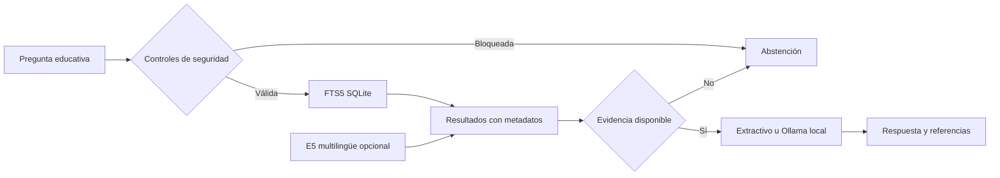

# Arquitectura y límites de confianza

- `corpus/cards.jsonl`: fichas ORIGINALES en español, no copia de ACR/RSNA/OpenStax.
- `corpus/sources.json`: lista de fuentes externas (incluye licencias, uso y fecha).
- `corpus/manifest.json`: SHA-256 de ambos archivos, barrera anti-regresión.
- Ingesta controlada y versionada. **No hay descarga o scraping de URLs**.
- SQLite FTS5: recuperador base. E5 multilingüe: embeddings en ejecución local, con prefijos `query:` y `passage:` y RRF.
- Modelos externos no se empacan en el repositorio. Ollama está restringido a loopback.
- Respuesta sin LLM: ensamblaje extractivo literal de fichas originales; con Ollama: cita validada sintácticamente, no validación de entailment.
- Privacidad: no se aceptan cargas de archivos ni datos de pacientes.
- Riesgo RAG: prompt injection, fuentes desactualizadas, citas sin soporte, retrieval erróneo y leakage. La mitigación debe ser evaluada, no asumida.
- Escalamiento posible: ETL Bronze/Silver/Gold, DuckDB, reranking, índices vectoriales, auditoría de chunking y relevancia con un corpus más amplio.
